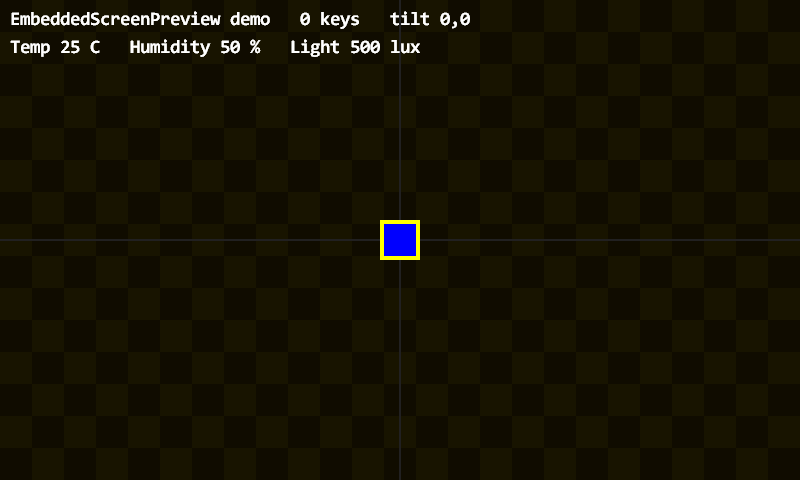
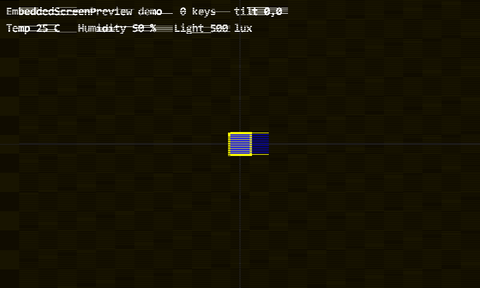

# EmbeddedScreenPreview

**English** | [中文](README_CN.md)

A generic Windows preview host for embedded projects that render into an
**RGB565 framebuffer**.

No flashing, no board, no CPU emulator. If your project ultimately writes pixels
into a framebuffer, this tool shows that framebuffer in a window while you work —
so the loop becomes *edit → build (2 s) → see it* instead of
*edit → build → flash → photograph the screen → squint*.

```
open fbview.exe  →  pick a project folder  →  it runs
```

---

## Demo

Normal rendering, and the same frame with the simulated SDRAM budget lowered to
55 MB/s. The horizontal streaking is the failure mode this model reproduces:

| normal | bandwidth-limited (55 MB/s) |
|---|---|
|  |  |

---

## How it works

The tool knows nothing about any specific project. A project provides a small
**adapter DLL** exporting five `Pv_*` functions. The host passes its capabilities
through an `FvHost` struct, so adapters never link back into the executable — no
import library, no exported symbols from the .exe.

```
    keyboard / clock
          │
          ▼
   ┌──────────────┐   FvHost { fb, w, h, draw_text, tilt, touch }
   │  fbview.exe  │ ──────────────────────────────────────────────┐
   └──────┬───────┘                                               │
          │ Pv_Attach / Pv_Update / Pv_Render / Pv_Key / Pv_Touch │
          ▼                                                       ▼
   ┌──────────────┐  writes RGB565 pixels   ┌──────────────────────┐
   │ adapter DLL  │ ──────────────────────▶ │ framebuffer (w × h)  │
   └──────────────┘                         └──────────────────────┘
```

Your own `game.c`, `app.c`, `render.c` — or any code that draws — stays
untouched. Only a thin adapter file and a small `preview.ini` are added.

---

## Quick start

```powershell
cd EmbeddedScreenPreview
.\build.ps1
.\fbview.exe
```

`fbview.exe` opens a folder picker. Choose a project folder containing an adapter
DLL or a `preview.ini`, and it starts.

Command line:

```powershell
.\fbview.exe -dir <project folder>
.\fbview.exe -dir <project folder> -export frame.bmp   # offscreen, no window
.\fbview.exe -dir <folder A> -dir <folder B>           # switchable projects
.\fbview.exe -bandwidth 55                             # simulate 55 MB/s SDRAM
.\fbview.exe -list                                     # check loadability only
```

> If PowerShell refuses to run the scripts ("not digitally signed"), use
> `powershell -NoProfile -ExecutionPolicy Bypass -File .\build.ps1`.

### Hotkeys

| Key | Action |
|---|---|
| `W` `A` `S` `D` | simulated tilt (ramps while held, decays on release) |
| `1` / `2` | KEY1 / KEY2, delivered to the adapter |
| `F1` | debug overlay: fps, frame time, resolution, bandwidth, tilt |
| `F12` | screenshot to `screenshots\shot_NNNN.bmp` |
| `Space` | pause / resume (still renders, logic frozen) |
| `F11` | fullscreen / restore |
| `R` | **reload the adapter DLL** — rebuild, press R, no restart |
| `Esc` | quit |

Mouse clicks over the window are mapped back to native LCD coordinates and
delivered to the adapter as touch input.

---

## Adapter discovery

| Order | Condition |
|---|---|
| 1 | `preview.ini` has `dll=` and the file exists → load it |
| 2 | any `*adapter*.dll` in the folder |
| 3 | `preview.ini` has `sources=` → compile with gcc into `_fbview\adapter.dll`, then load |
| 4 | none of the above → an error dialog explains what is missing |

Compilation happens once; the result is cached in `_fbview\`. Delete that folder
to force a rebuild.

### `preview.ini`

```ini
width=800
height=480
fps=30
title=My project

dll=my_adapter.dll

; used only when the DLL is absent (comma separated, relative to this folder)
sources=src\adapter.c,src\game.c,src\render.c
includes=src
defines=PC_PREVIEW
```

---

## Writing an adapter

Full example: [`demo_adapter.c`](demo_adapter.c) — about 60 lines.

```c
#define FBVIEW_BUILD_DLL          /* must come before the include */
#include "fbview.h"

static const FvHost *s_host;

int  Pv_Attach(const FvHost *host)            { s_host = host; return 0; }
void Pv_Update(float tx, float ty, float dt)  { /* your logic */ }
void Pv_Render(void)                          { /* write RGB565 into s_host->fb */ }
void Pv_Key(int key)                          { }
void Pv_Touch(int x, int y, int pressed)      { }
const char *Pv_Title(void)                    { return "my project"; }
```

Build it:

```powershell
gcc -std=c11 -O2 -shared -DFBVIEW_BUILD_DLL -I<this folder> -I<your headers> `
    -o <project folder>\my_adapter.dll adapter.c your_other_sources.c
```

### What the host provides (`FvHost`)

| Field | Meaning |
|---|---|
| `fb` | framebuffer, `uint16_t*`, RGB565, length `w*h` |
| `w`, `h` | size, taken from `preview.ini` |
| `draw_text(s, x, y, c565)` | draw a string with a system font — **overlay only, not written into the framebuffer**, so exported BMPs contain no text |
| `tilt_x`, `tilt_y` | current simulated tilt |
| `fps` | target frame rate |

---

## SDRAM bandwidth model

`fv_sim.c` implements a frame-level contention model, deliberately documented as
a *teaching model*, not a cycle-accurate FMC simulation:

```
read  = pixels × 2 bytes × scan_hz           (the display controller always reads)
write = pixels × 2 bytes × fps × passes      (the CPU writes)
```

When demand exceeds the configured budget, grants accumulate per 64-byte read
burst; a burst that is not granted repeats the last delivered pixel, which
produces exactly the horizontal streaking seen on real hardware when the pixel
clock is set too high for the memory bus.

At 800×480 RGB565 and 30 fps: `scan 46.08 + write 23.04 = 69.12 MB/s`.

---

## Build and test

```powershell
.\build.ps1        # fbview.exe + demo_adapter.dll
.\test.ps1         # loader / sim / preview / terminal / offscreen export
```

Requires gcc (MSYS2 mingw64) and Windows system libraries only
(`gdi32`, `user32`, `shell32`, `ole32`, `comctl32`). No third-party dependencies.

The regression suite covers: adapter reload and failure cleanup, viewport math
and bandwidth thresholds, starvation and recovery, project switching and
rollback, tilt direction, touch start/pause/cancel, terminal capture and
descriptor restoration, and BMP header validation of the offscreen export.

---

## Known limitations

| Limitation | Reason |
|---|---|
| No LTDC timing model | this is not a hardware simulator |
| Bandwidth is frame-level, not per-scanline | see the roadmap |
| Writes always win arbitration | real FMC contends in both directions |
| `write_passes` is a manual estimate | adapters cannot report actual write volume yet |
| Text is a GDI overlay, absent from exports | avoids shipping a font table |

Hardware-level verification (interrupts, DMA, real timing) needs a different
class of tool, such as Renode with its `Video.STM32LTDC` model.

See [ROADMAP.md](ROADMAP.md) for the intended evolution: per-scanline display
clock with FIFO and arbitration, virtual clock and deterministic replay,
peripheral models, and only then execution of real firmware images.

---

## License

MIT — see [LICENSE](LICENSE).
